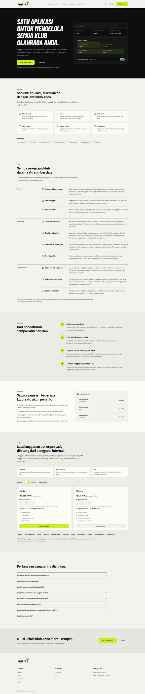
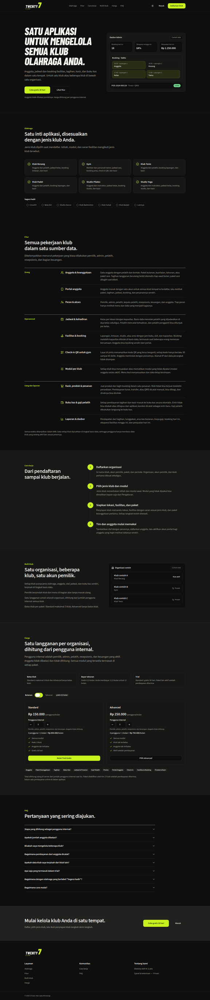

# landing-polish progress

Status: all items done (404, error pages, Fitur and Cara kerja, shadows, hover, square labels, ruled FAQ, light bands).

- [x] Branded `app/not-found.tsx` and `app/error.tsx` (shared `components/shared/status-page.tsx`), pushed.
- [x] Recompose Fitur and Cara kerja (approved from the mock, applied). Fitur: three groups (Orang, Operasional, Uang dan laporan), each a label column and a divided list of icon, title and unchanged body text, no cards. Cara kerja: sticky heading on the left, vertical stepper on the right. Copy unchanged.
  - Fitur:   
  - Cara kerja:   
  - 404: 
- [x] Remaining audit items (hover states, tinted shadows, dark bands, FAQ, pills): done in the three items below (checked 2026-10-24; the line was not updated when they shipped).
- [x] Tinted shadow token `--shadow-ink`, button and nav hover, square labels, ruled FAQ (applied).
- [x] Dark bands (Multi klub, CTA akhir) to light: approved from the mock, applied.  
