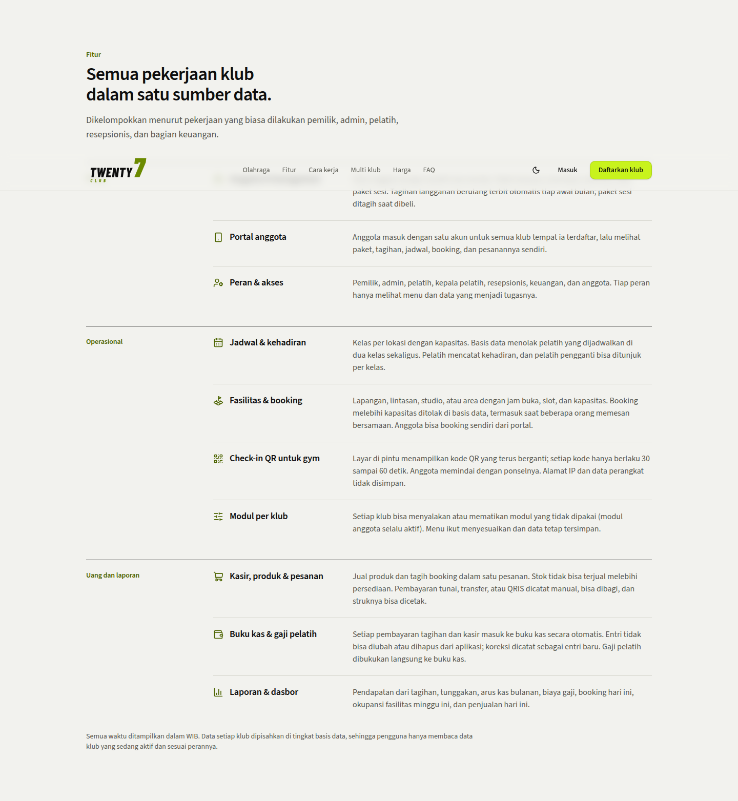
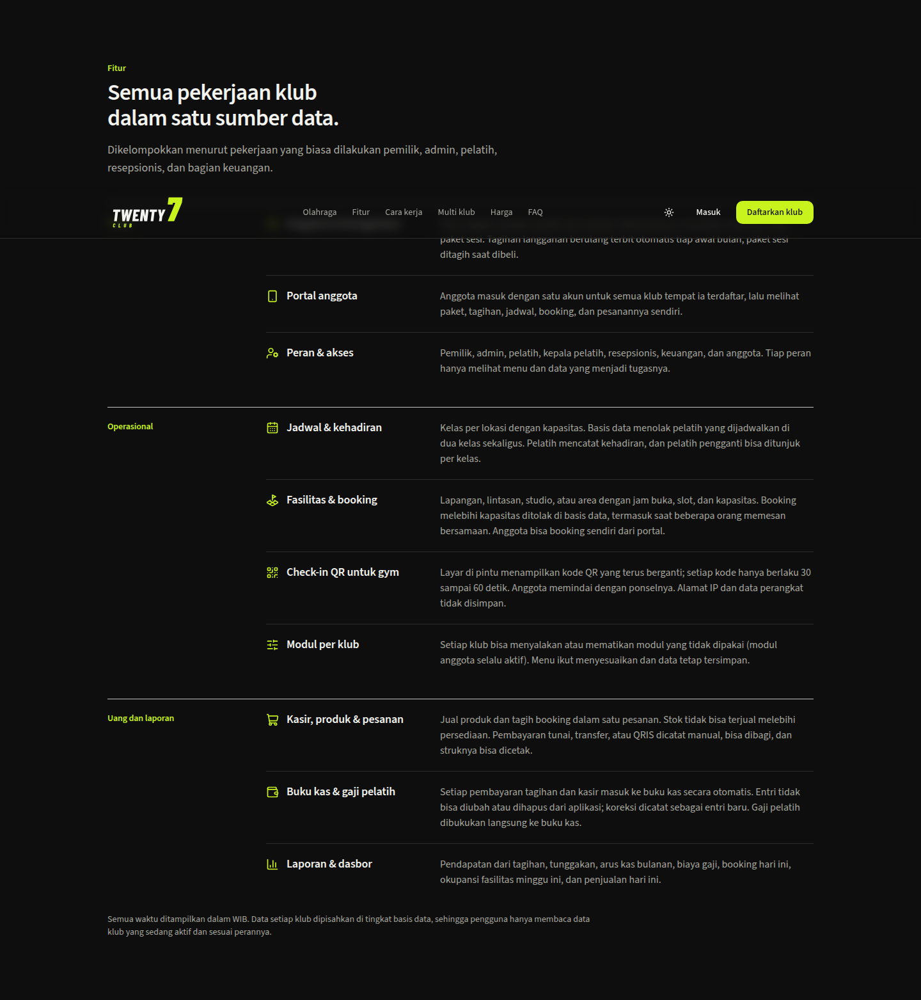
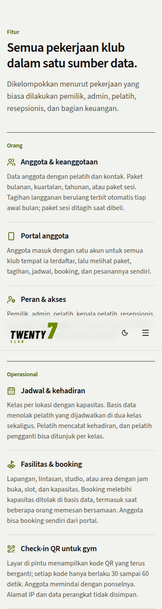
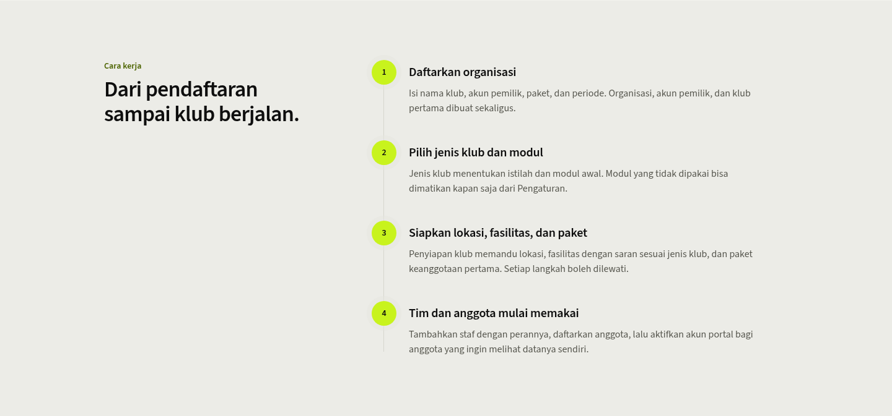
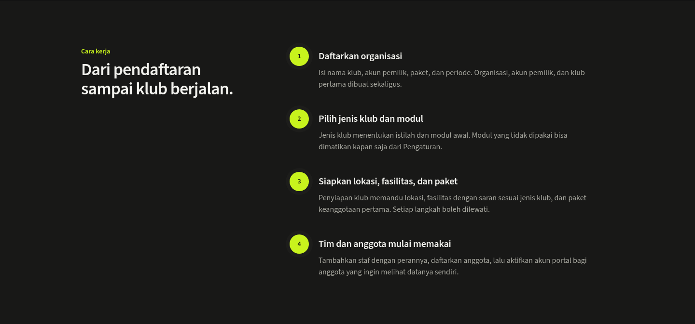
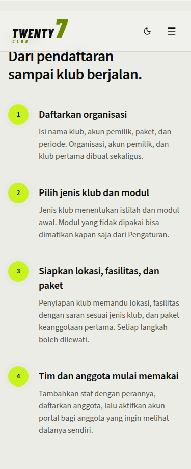
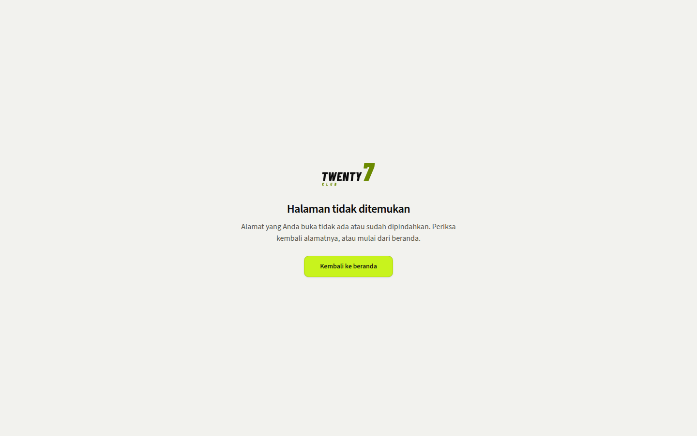

# landing-polish progress

Status: 404 and error pages done; Fitur and Cara kerja recompose is a mock, waiting for OK.

- [x] Branded `app/not-found.tsx` and `app/error.tsx` (shared `components/shared/status-page.tsx`), pushed.
- [ ] Recompose Fitur and Cara kerja (mock only, reverted). Fitur: three groups (Orang, Operasional, Uang dan laporan), each a label column and a divided list of icon, title and unchanged body text, no cards. Cara kerja: sticky heading on the left, vertical stepper on the right. Copy unchanged.
  - Fitur:   
  - Cara kerja:   
  - 404: 
- [ ] Remaining audit items (hover states, tinted shadows, dark bands, FAQ, pills): not started.
