# redesign-brand-c progress

Status: Superseded by redesign-brand-a-volt (see `progress/redesign-brand-a-volt-progress.md`). Its audit and token table remain valid.

- [x] Phase 0 — audit, token table, before and mock screenshots
- [ ] Phase 1 — tokens, fonts, brand assets, icons
- [ ] Phase 2 — shell and shared components
- [ ] Phase 3 — landing and auth pages
- [ ] Phase 4 — page sweep, after screenshots, changelog

Precondition checked: `progress/profile-username-progress.md` has all five phases done.

## Phase 0 — audit (done)

Commits: `8bf192b` (CLAUDE.md builder workflow), this file. Check: no code changed in this phase; the mock was applied locally, screenshotted and reverted.

### Findings

Shell and shared components
1. Colours are already central: every token is in `app/globals.css`. Outside it, old colours remain only in `app/opengraph-image.tsx` (`#0a2f4d`, `#7dd3fc`, `#9cc6e0`, `#e5f1fa`) and the `#2563eb` placeholder of the club colour field (`components/settings/tenant-branding-form.tsx`, an example value for club data, not a theme colour). The `0369a1`, `38bdf8` and `sky-` matches are all in `globals.css`.
2. `text-primary` is used 40 times as a text colour (club name in the top bar, links, landing labels). Once `--primary` is volt, that text drops to 1.15:1 on the light background. Plan: these become `text-accent-foreground` (dark volt in light, volt in dark). `border-primary` (10) and `bg-primary` (20) stay, because they are fills and borders.
3. The `h1`–`h6` font rule in `globals.css` sits outside any layer, so it beats Tailwind utilities (a heading cannot take another font class). It moves into `@layer base`.
4. `font-heading` (Lexend) is used 24 times. Per decision 2 it maps to Source Sans 3, and a new `font-display` (Bebas Neue) is used only for the `PageHeader` title, `MetricCard` values and the landing hero.
5. The sidebar mark is `APP_NAME.charAt(0)`, which renders "2" for "27 Club". It gets replaced by the logo.
6. Sidebar group labels and landing section labels are uppercase with wide tracking (5 places), a generic pattern the skill flags.
7. The favicon is the default `app/favicon.ico`; there is no `icon.svg`, `apple-icon.png` or brand OG image.

Pages
8. Member home (`/member`): sections are bare headings and tables, without the framed cards the admin pages use, so it looks unfinished next to the rest.
9. Auth pages (`/login`, `/daftar`, `/superadmin/login`, `/change-password`) use `Card frame={false}` on the old blue-tinted background, with no brand mark beyond text.
10. Superadmin portal: its own header with a text-only `APP_NAME Platform` mark.
11. Coach pages: same shell as admin; no one-off colours found.
12. Landing: the hero is a light block with the product preview; the header and footer use a text mark in `text-primary`.

Seen in the mock (needs a decision, see below)
13. Bebas Neue has capitals only. Numbers look strong ("1 / 0", "18"), but text values become shouted and truncated ("BELUM ADA JAM BU…", "RP 0 (0 PESANAN)").
14. A volt button on the light background has almost no edge (1.15:1 against `#F2F2EE`). The label is 15:1, so it passes WCAG, but the button shape is faint.

### Token table (measured, WCAG contrast ratio)

| Token | Light | Dark |
|---|---|---|
| `--background` | `#F2F2EE` | `#0E0E0E` |
| `--foreground` | `#0E0E0E` (17.2:1 on background) | `#F2F2EE` (17.2:1) |
| `--card` | `#FBFBF8` (foreground 18.6:1) | `#171716` (foreground 16.0:1) |
| `--muted` / `--secondary` / `--accent` (surfaces) | `#E6E6E0` | `#21211F` |
| `--muted-foreground` | `#57574F` (6.5:1 background, 7.0:1 card, 5.8:1 muted) | `#A6A69E` (7.9:1, 7.3:1, 6.6:1) |
| `--primary` / `--primary-foreground` | `#C8F31D` / `#0E0E0E` (15.0:1) | same |
| `--accent-foreground` (accent text, links) | `#4D6400` (6.0:1 background, 6.5:1 card, 5.3:1 muted) | `#C8F31D` (15.0:1, 13.9:1, 12.5:1) |
| `--ring` (focus) | `#4D6400` (6.0:1) | `#C8F31D` (15.0:1) |
| `--border` / `--input` | `#D6D6CE` | `#2C2C29` |
| `--success` | `#276B2B` (white text 6.4:1) | `#6FD38A` (10.4:1 on background) |
| `--warning` | `#9A5800` (white text 5.6:1, 5.0:1 on background) | `#F5B544` (10.6:1) |
| `--destructive` | `#C62828` (white text 5.6:1, 5.0:1 on background) | `#FF7A6E` (7.6:1) |
| Sidebar active item | `#C8F31D` fill, `#0E0E0E` text (15.0:1) | same |

The logo's own dark volt (`#6B8A00`, 3.6:1) is used only inside the logo file, never as text colour.

### Screenshots (1440 × 900, light; dark mock for the member page)

Before:
- 
- 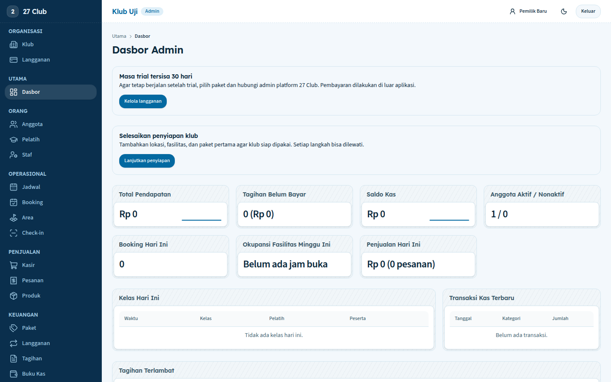
- 

Mock (new tokens, Bebas Neue display, logo in the sidebar and landing header, dark hero):
- 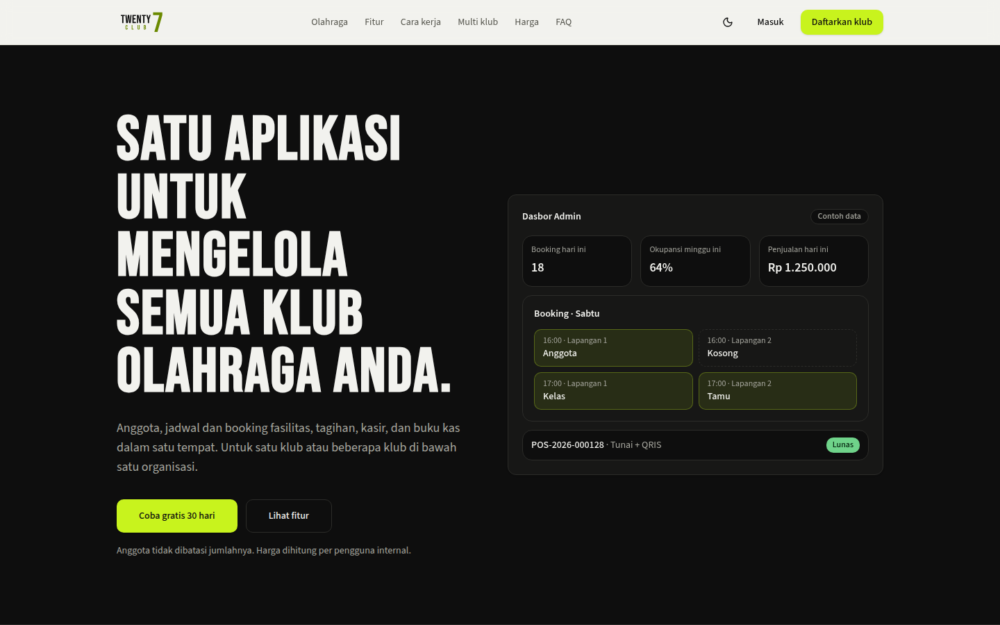
- 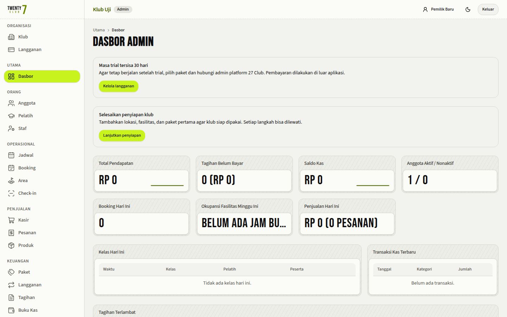
- 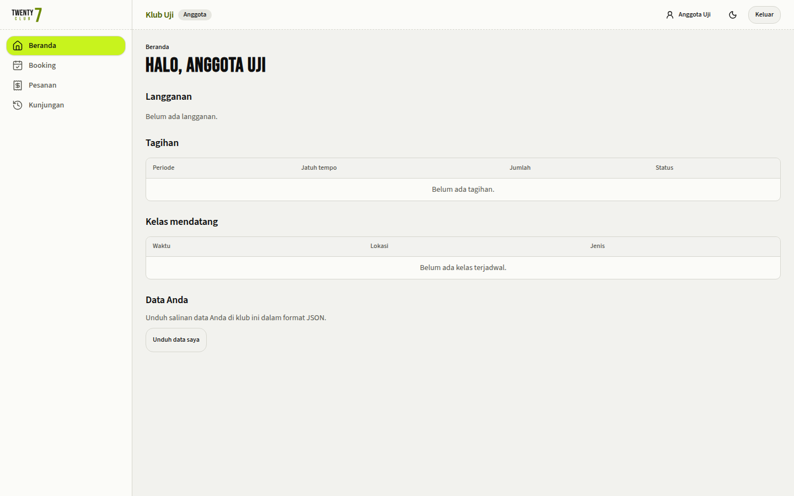
- Dark: 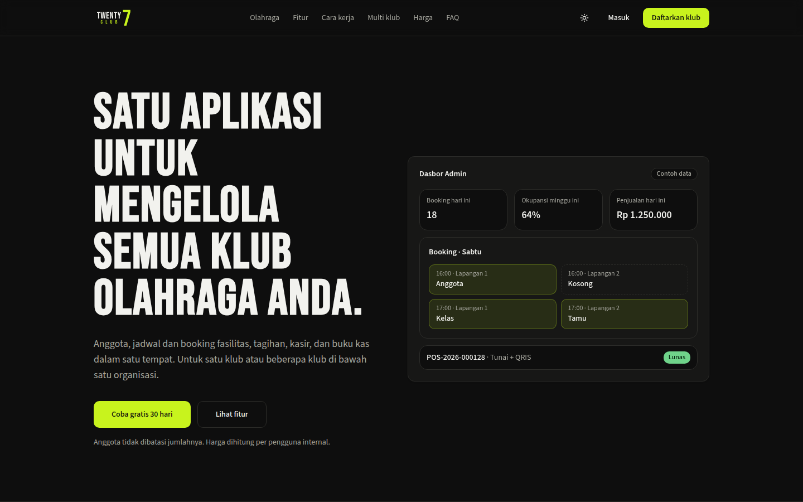 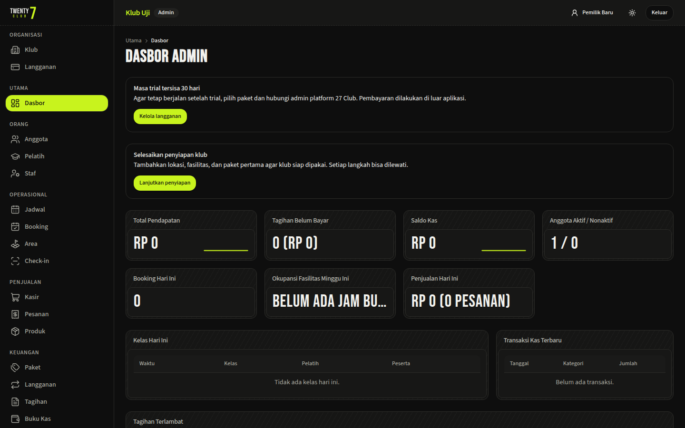 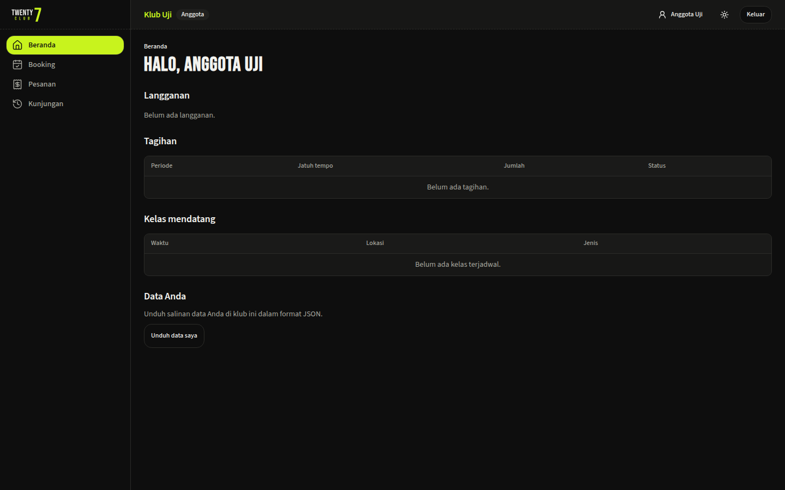

### Waiting for OK — open visual decisions

1. **Sidebar in light mode:** follow the theme (off-white sidebar with `logo-c-on-light`, as in the mock), or stay dark (`#0E0E0E` with `logo-c-on-dark`) in both themes? Decision 3 suggests following the theme.
2. **`MetricCard` values:** Bebas Neue for numbers and amounts only, with text values ("Belum ada jam buka") in Source Sans 3, or Bebas for every value?
3. **Volt button edge on light pages:** add a thin `#0E0E0E` border at 15% opacity to primary buttons in light mode, or leave the fill as is?
4. **Uppercase labels:** change the sidebar group labels and the landing section labels to sentence case, or keep the uppercase small labels?

### Mock with logo A (requested 2026-10-12)

Logo A (`27club-brand-a.zip`): charcoal `#15161A`, red `#E23B2E`, off-white `#F6F4F1`, heavy italic condensed lettering. Mock tokens (applied locally, screenshotted, reverted):

| Token | Light | Dark |
|---|---|---|
| Background / foreground | `#F6F4F1` / `#15161A` (16.5:1) | `#15161A` / `#F6F4F1` (16.5:1) |
| Card | `#FDFCFA` | `#1E1F24` |
| Muted foreground | `#5A5852` (6.5:1) | `#A8A59E` (7.4:1) |
| Primary button | `#C42E22` fill, white text (5.6:1) | same |
| Accent text, links, focus ring | `#B8261B` (5.7:1) | `#FF6B5E` (6.5:1) |
| Destructive | `#9F1239` | `#FB7185` |
| Sidebar active item | `#15161A` fill, off-white text | `#C42E22` fill, white text |

Display font in the mock: Barlow Condensed 800 italic (closest Google font to the logo lettering; not settled).

Notes from the A mock:
- The logo's own red `#E23B2E` fails as a button colour: white text on it is 4.29:1 and charcoal 4.22:1. Buttons use the darker `#C42E22`; `#E23B2E` stays in the logo and large display type only.
- Brand red and the error colour are the same hue. The mock moves destructive to a rose (`#9F1239` / `#FB7185`) so errors still read differently from primary buttons. Without that, a red "Hapus" button and a red "Simpan" button look alike.
- At 36–40 px tall, the small "CLUB" line of logo A is barely legible; the full logo needs about 48 px, or the icon in tight spots.
- Italic all-caps display type has the same problem as Bebas for text values in `MetricCard` ("BELUM ADA JAM …").

Screenshots:
- 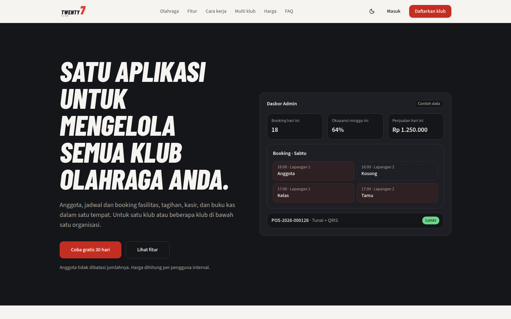 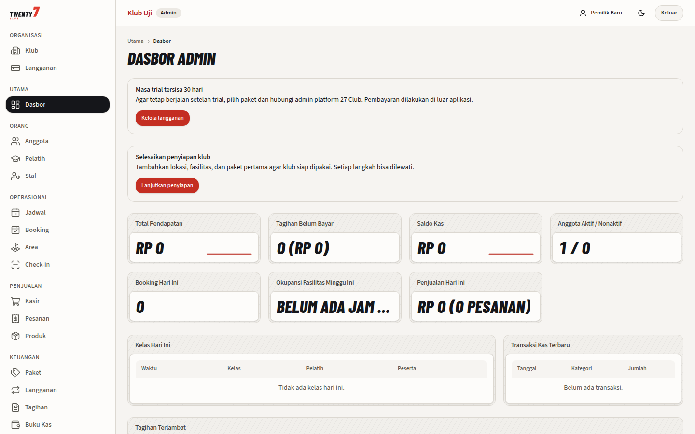 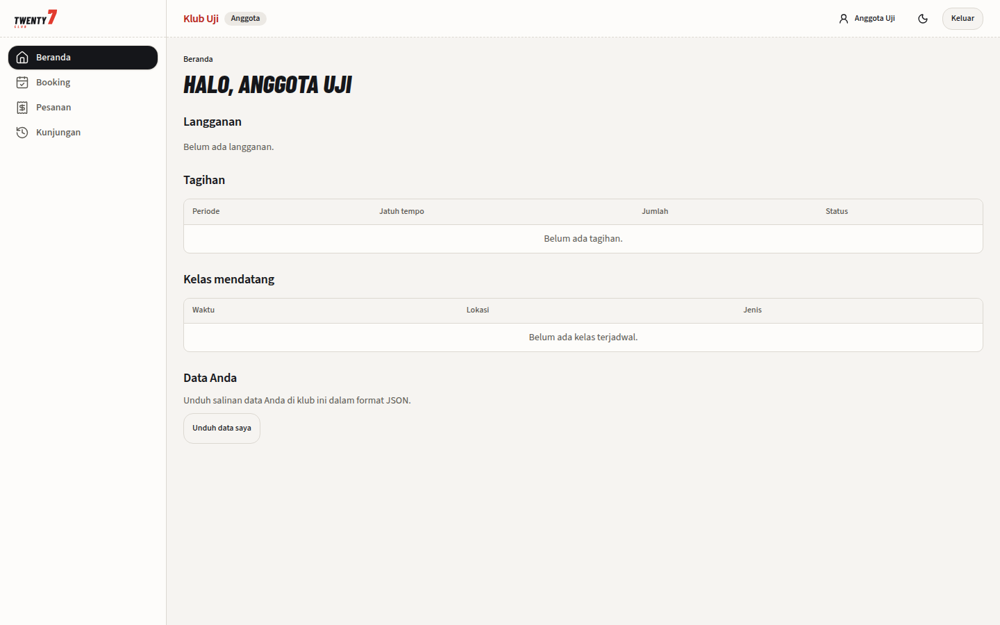
- Dark: 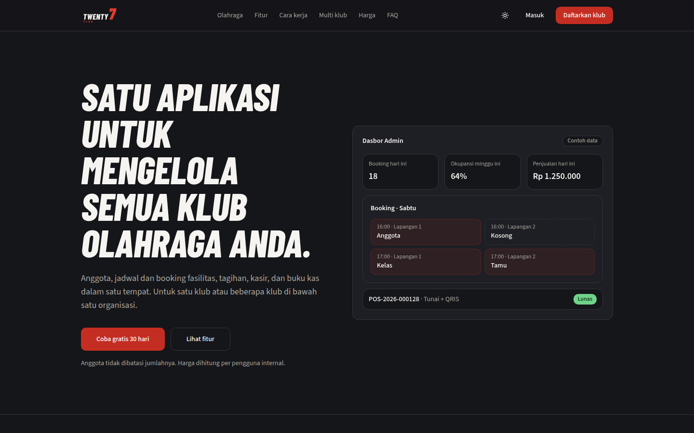 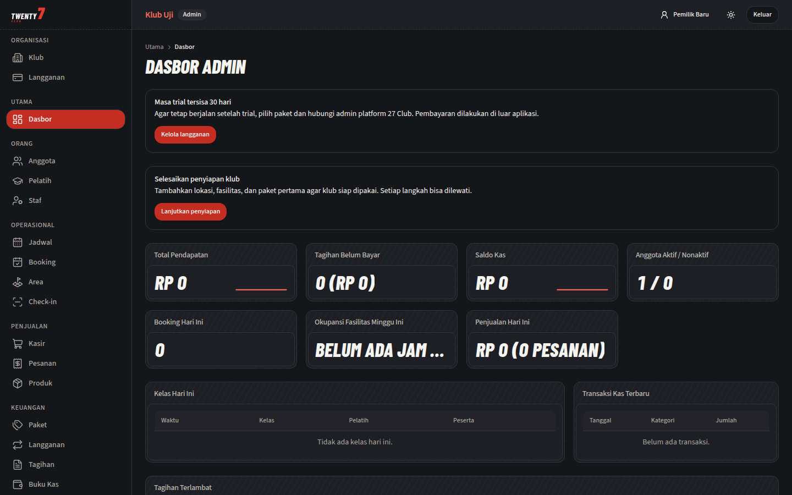 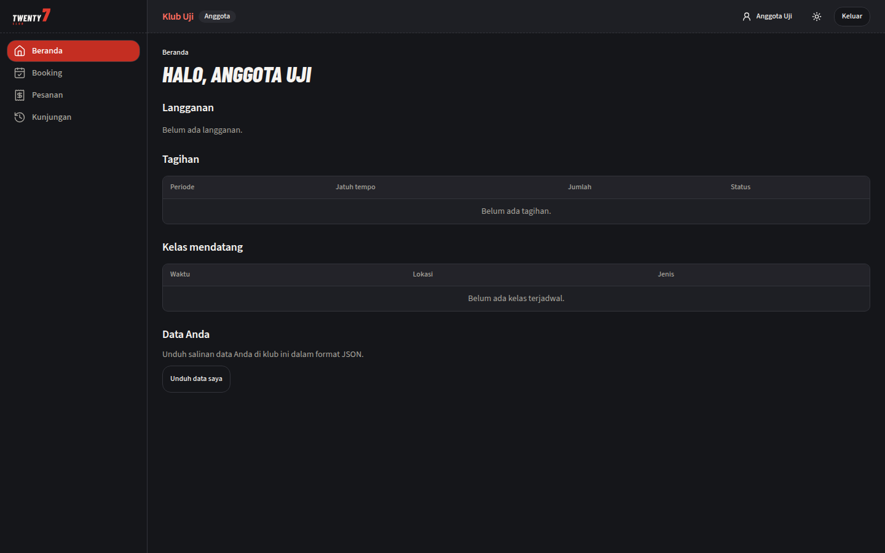

Waiting for: the choice between logo C and logo A, plus the four open decisions above.
